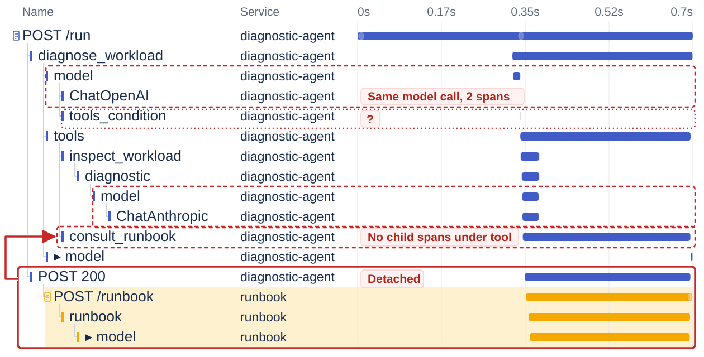
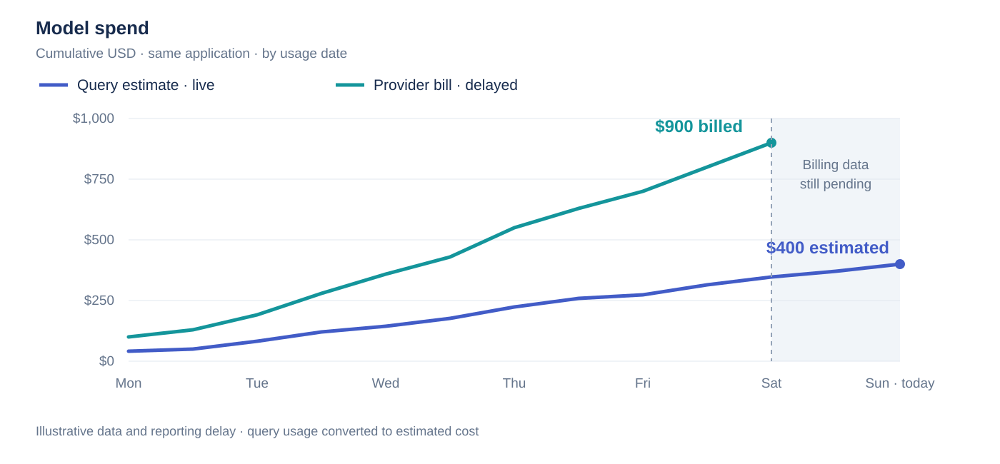
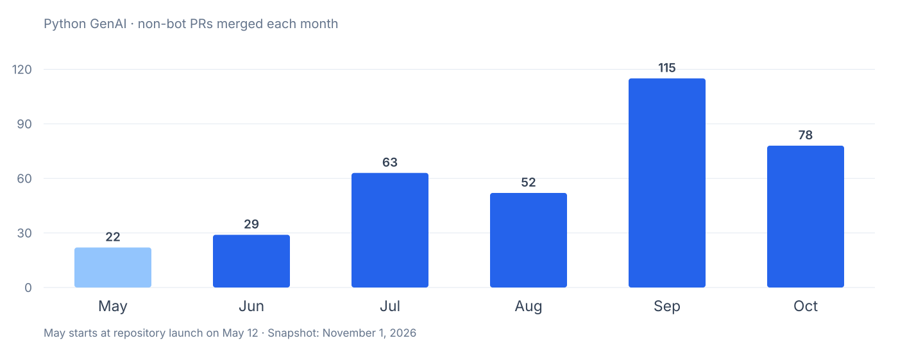
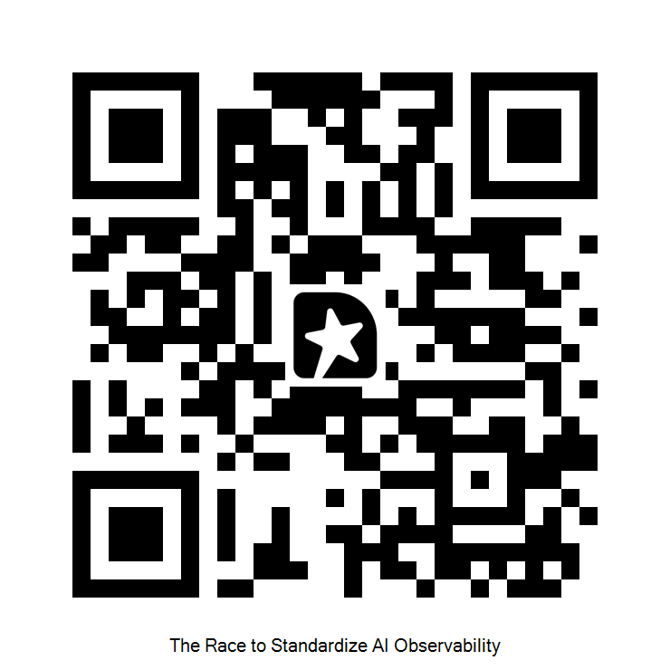

<!-- layout: branded-cover -->

# The Race to Standardize AI Observability

Liudmila Molkova, Google · Trask Stalnaker, Microsoft

KubeCon + CloudNativeCon North America 2026

---

<!-- layout: quote -->

# The promise of OpenTelemetry

> To enable effective observability by making high-quality, portable telemetry ubiquitous.

[open-telemetry/community](https://github.com/open-telemetry/community/blob/main/mission-vision-values.md#mission)

---

<!-- layout: diagram -->

# Our application

Investigates Kubernetes incidents: *"Why is checkout restarting, and what should I do?"*


---

<!-- layout: branded-transition -->

# Demo

---

<!-- layout: diagram -->

# Three flavors, one broken trace



---

<!-- layout: diagram -->

# One standard


---

# Querying token usage

```sql
SELECT COUNT(*) AS calls,
  SUM("gen_ai.usage.input_tokens") AS input_tokens
FROM span_data
WHERE trace_id = :trace_id
  AND "gen_ai.operation.name" = 'chat';
```

<div class="query-output">
<p class="query-output-label">Query result · 1 row</p>
<table aria-label="Query result: 2 calls and 280 input tokens">
<thead><tr><th scope="col">calls</th><th scope="col">input_tokens</th></tr></thead>
<tbody><tr><td>2</td><td>280</td></tr></tbody>
</table>
</div>

---

<!-- layout: diagram -->

# Dashboard usage vs. reality



---

<!-- layout: diagram -->

# How did we instrument the application?


---

# Accounting for different schemas

```sql
WITH calls AS (
  SELECT COALESCE(
    "gen_ai.usage.input_tokens",
    "llm.token_count.prompt"
  ) AS input_tokens
  FROM span_data WHERE trace_id = :trace_id AND (
    "gen_ai.operation.name" = 'chat'
    OR lower("openinference.span.kind") = 'llm'
    OR lower("langsmith.span.kind") = 'llm'
  )
)
SELECT COUNT(*) AS calls, SUM(input_tokens) AS input_tokens
FROM calls;
```

<div class="query-output">
<p class="query-output-label">Query result · 1 row</p>
<table aria-label="Query result: 5 calls and 900 input tokens">
<thead><tr><th scope="col">calls</th><th scope="col">input_tokens</th></tr></thead>
<tbody><tr><td>5</td><td>900</td></tr></tbody>
</table>
</div>

---

<!-- layout: text -->

# Back to the OpenTelemetry mission

<table class="mission-table">
<tbody>
<tr><th>Portable</th><th class="fragment" data-fragment="semconv">GenAI semantic conventions</th></tr>
<tr><td>Every library invents its own span and attribute names</td><td class="fragment" data-fragment="semconv"><b>Standard span and attribute names</b></td></tr>
<tr><td>Each library records prompts and responses its own way</td><td class="fragment" data-fragment="semconv"><b>Structured inputs and outputs</b></td></tr>
<tr><td>No AI metrics, so counting tokens meant querying traces</td><td class="fragment" data-fragment="semconv"><b>Standard token and latency metrics</b></td></tr>
<tr><th>High-quality</th><th class="fragment" data-fragment="instr">Instrumentation patterns</th></tr>
<tr class="later"><td>Duplicate spans and a broken trace</td><td class="fragment" data-fragment="instr">Later in the talk</td></tr>
</tbody>
</table>

---

<!-- layout: diagram -->

# GenAI semantic conventions

[open-telemetry/semantic-conventions-genai](https://github.com/open-telemetry/semantic-conventions-genai)


---

# GenAI attributes

<div style="display: flex; align-items: center; gap: 24px;">
<div style="flex: 0 0 26%;">
<ul class="attr-key">
<li style="--c: #d64545;">Agent / workflow identity</li>
<li style="--c: #425cc7;">Model details and request parameters</li>
<li style="--c: #f5a800;">Token usage</li>
<li style="--c: #0f8188;">Inputs, outputs, and instructions</li>
<li style="--c: #a3367a;">Tool definitions, calls, and results</li>
</ul>
</div>
<div style="flex: 1; min-width: 0;">
<table class="attr-table" aria-label="GenAI attributes from the demo trace">
<tr style="--c: #d64545;"><th scope="row">gen_ai.agent.name</th><td>diagnostic</td></tr>
<tr style="--c: #425cc7;"><th scope="row">gen_ai.operation.name</th><td>chat</td></tr>
<tr style="--c: #425cc7;"><th scope="row">gen_ai.provider.name</th><td>openai</td></tr>
<tr style="--c: #425cc7;"><th scope="row">gen_ai.request.model</th><td>gpt-4.1</td></tr>
<tr style="--c: #425cc7;"><th scope="row">gen_ai.response.model</th><td>gpt-4.1</td></tr>
<tr style="--c: #425cc7;"><th scope="row">gen_ai.response.id</th><td>chatcmpl-4021efaa4f924ee6a425ecde938da86d</td></tr>
<tr style="--c: #425cc7;"><th scope="row">gen_ai.response.finish_reasons</th><td>["tool_calls"]</td></tr>
<tr style="--c: #f5a800;"><th scope="row">gen_ai.usage.input_tokens</th><td>120</td></tr>
<tr style="--c: #f5a800;"><th scope="row">gen_ai.usage.output_tokens</th><td>30</td></tr>
<tr style="--c: #0f8188;"><th scope="row">gen_ai.input.messages</th><td class="wrap">[{"role":"user","parts":[{"content":"Why is checkout restarting, and what should I do?","type":"text"}]}]</td></tr>
<tr style="--c: #0f8188;"><th scope="row">gen_ai.output.messages</th><td class="wrap">[{"role":"assistant","parts":[{"arguments":{"workload":"checkout"},"name":"inspect_workload","type":"tool_call"}]}]</td></tr>
<tr style="--c: #a3367a;"><th scope="row">gen_ai.tool.definitions</th><td class="wrap">[{"name":"inspect_workload","description":"Inspect Kubernetes evidence for a workload."}]</td></tr>
</table>
</div>
</div>

---

# Structured inputs and outputs

`gen_ai.input.messages`

```json
[{"role": "user", "parts": [{
  "type": "text",
  "content": "Why is checkout restarting, and what should I do?"
}]}]
```

`gen_ai.output.messages`

```json
[{"role": "assistant", "finish_reason": "tool_calls", "parts": [
  {"type": "tool_call", "id": "call_diagnose",
   "name": "inspect_workload", "arguments": {"workload": "checkout"}},
  {"type": "tool_call", "id": "call_runbook",
   "name": "consult_runbook", "arguments": {"topic": "OOMKilled"}}
]}]
```

---

# Conversation view

<div class="aspire" role="group" aria-label="Aspire-style view of the final inference span">
<div class="aspire-header"><span class="aspire-title">diagnostic-agent: chat gpt-4.1</span><span class="aspire-span-id">6483b37</span><span class="aspire-llm">LLM</span><span class="aspire-tabs"><span class="active">Input &amp; output</span><span>Tools 2</span><span>Details</span></span><span class="aspire-stats">Duration <b>1.88ms</b> · Tokens <b>360</b></span></div>
<div class="aspire-body">
<p class="aspire-section">Input</p>
<div class="aspire-grid">
<div class="aspire-col-left">
<div class="aspire-card"><span class="aspire-role aspire-user">User</span><span class="aspire-badge message">&#9993; Message</span><div class="aspire-content">Why is checkout restarting, and what should I do?</div></div>
<div class="aspire-card"><span class="aspire-role aspire-assistant">Assistant</span><span class="aspire-badge tool-calls">&lt;/&gt; Tool calls</span><div class="aspire-content"><span class="fn">inspect_workload</span>({"workload": <span class="str">"checkout"</span>})
<span class="fn">consult_runbook</span>({"topic": <span class="str">"OOMKilled"</span>})</div></div>
<p class="aspire-section aspire-output-heading">Output</p>
</div>
<div>
<div class="aspire-card"><span class="aspire-role aspire-user">User</span><span class="aspire-badge tool-response">&#9993; Tool response</span><div class="aspire-content">{"evidence": <span class="str">"checkout was OOMKilled; memory limit is 128Mi and peak usage is 192Mi."</span>}</div></div>
<div class="aspire-card"><span class="aspire-role aspire-user">User</span><span class="aspire-badge tool-response">&#9993; Tool response</span><div class="aspire-content">{"recommendation": <span class="str">"Inspect the memory regression; raise the limit only after checking cluster capacity."</span>}</div></div>
</div>
</div>
<div class="aspire-card" style="margin-bottom: 0;"><span class="aspire-role aspire-assistant">Assistant</span><span class="aspire-badge output">&#9993; Output</span><div class="aspire-content">Checkout exceeded its 128Mi memory limit. Investigate the regression and review capacity before changing limits.</div></div>
</div>
</div>

---

# Common metrics

<table class="promql-table">
<thead><tr><th></th><th class="fragment" data-fragment="data">PromQL</th></tr></thead>
<tbody>
<tr><td>Input / output tokens</td><td class="fragment" data-fragment="data"><pre><code>sum(increase({"gen_ai.client.inference.usage.input_tokens"}[5m]))
sum(increase({"gen_ai.client.inference.usage.output_tokens"}[5m]))</code></pre></td></tr>
<tr><td>Cached input tokens</td><td class="fragment" data-fragment="data"><pre><code>sum(increase({"gen_ai.client.inference.usage.cache_read.input_tokens"}[5m]))</code></pre></td></tr>
<tr><td>p95 time to first chunk</td><td class="fragment" data-fragment="data"><pre><code>histogram_quantile(0.95, sum(rate(
  {"gen_ai.client.inference.time_to_first_chunk"}[5m])))</code></pre></td></tr>
<tr><td>p95 duration by operation</td><td class="fragment" data-fragment="data"><pre><code>histogram_quantile(0.95,
  sum by ("gen_ai.operation.name") (rate(
    {"gen_ai.client.inference.duration"}[5m])))</code></pre></td></tr>
<tr><td>Failed calls per second</td><td class="fragment" data-fragment="data"><pre><code>sum(histogram_count(rate(
  {"gen_ai.client.inference.duration", "error.type"!=""}[5m])))</code></pre></td></tr>
</tbody>
</table>

<!-- Queries use native histograms and preserve original OTel metric and attribute names. Each expression is a separate query. Sources: https://github.com/open-telemetry/semantic-conventions-genai/blob/main/docs/gen-ai/client-inference.md https://github.com/open-telemetry/semantic-conventions-genai/blob/main/docs/gen-ai/gen-ai-token-metrics.md https://prometheus.io/docs/guides/utf8/ https://prometheus.io/docs/prometheus/latest/querying/functions/ -->

---

# GenAI observability in 2026

<ol class="project-timeline" aria-label="2026 project milestones">
<li><div><time>February</time><p>GenAI support in OTel eBPF instrumentation</p></div></li>
<li><div><time>March</time><p>OpenLLMetry adopts GenAI conventions</p></div></li>
<li><div><time>May</time><p>Dedicated GenAI repositories</p></div></li>
<li><div><time>June</time><p>OpenInference adopts conventions, contributes code</p></div></li>
<li><div><time>July</time><p>Python GenAI beta</p><p>Go compile-time GenAI instrumentation</p></div></li>
<li><div><time>August</time><p>Conformance tests</p></div></li>
<li><div><time>September</time><p>GenAI semconv stabilization starts</p></div></li>
<li><div><time>October-November</time><p>Native Anthropic tracing</p><p>More Java and JavaScript integrations</p></div></li>
</ol>

<!-- Sources and qualifications: sources.md, "Project timeline: slide 17". Milestones are selected events, spaced evenly rather than to a calendar scale. -->

---

<!-- layout: branded-transition -->

# From conventions to instrumentation

---

# How we build instrumentations

[open-telemetry/opentelemetry-python-genai](https://github.com/open-telemetry/opentelemetry-python-genai)

- **One shared GenAI Util** owns spans, metrics, content capture, and context
- **Thin adapters** only map each library's data to GenAI Util types
- **Conformance checks + unit tests** verify each package against the conventions
- **AI-assisted development:** AGENTS.md, skills, and automated pre-review

---

# Inside an instrumentation

<div class="adapter-grid">
<div>

```python
def traced_create(wrapped, instance, args, kwargs):
    # Starts the span; on exit ends it and
    # records metrics and errors
    with handler.inference(
        provider="anthropic", request_model=kwargs["model"]
    ) as invocation:

        # Map Anthropic request to GenAI types
        set_request_attributes(invocation, kwargs)

        result = wrapped(*args, **kwargs)

        # Map response: model, usage, finish reasons
        set_response_attributes(invocation, result)
        return result
```

</div>
<div class="adapter-util">
<p class="adapter-util-title">GenAI Util handles</p>
<ul>
<li>Spans and attributes</li>
<li>Metrics</li>
<li>Content capture</li>
<li>Errors</li>
<li>Context</li>
</ul>
</div>
</div>

<!-- Simplified from opentelemetry-instrumentation-genai-anthropic patch.py (messages_create + _create_invocation): set_request_attributes and set_response_attributes stand in for the request and response mapping; streaming, server address, beta resources, and raw responses omitted. The invocation's context manager calls stop() or fail() on exit; upstream calls them explicitly so streamed responses can finish after the call returns. -->


---

# More contributors, faster delivery

- **At least 143 contributors to OTel AI work in 2026, 65 new to OTel**
- **13 Python instrumentations released in 2026**



---

# Native instrumentation

<p class="native-lead">Libraries that emit OTel themselves are better for users and the ecosystem</p>

<ul class="native-grid" aria-label="Libraries with native OpenTelemetry GenAI instrumentation">
<li><b>Anthropic SDK</b><span>Model provider</span></li>
<li><b>MCP SDKs</b><span>Tool protocol</span></li>
<li><b>Microsoft Agent Framework</b><span>Agent framework</span></li>
<li><b>AWS Strands</b><span>Agent framework</span></li>
<li><b>Google ADK</b><span>Agent framework</span></li>
<li><b>Vercel AI SDK</b><span>App SDK</span></li>
</ul>

---

<!-- layout: branded-transition -->

# Every instrumentation needs conformance tests

---

# OpenTelemetry Weaver

[open-telemetry/weaver](https://github.com/open-telemetry/weaver)

<div class="adapter-grid" style="grid-template-columns: 1fr auto;">
<div>

- **Conventions** defined in machine-readable YAML
- **Weaver** validates schemas and generates docs &amp; code
- **Live check** verifies OTLP telemetry against the schema:
  - required attributes, allowed attributes, types &amp; enums

</div>
<div>

```yaml
file_format: definition/2
spans:
  - type: gen_ai.client.inference
    kind: client
    brief: Client call to a GenAI model
    attributes:
      - ref: gen_ai.operation.name
      - ref: gen_ai.provider.name
      - ref: gen_ai.request.model
      - ref: gen_ai.usage.input_tokens
```

</div>
</div>

---

# Conformance testing with Weaver

[open-telemetry/semantic-conventions-conformance](https://github.com/open-telemetry/semantic-conventions-conformance)

<div class="code-grid" style="display: grid; grid-template-columns: auto auto auto; gap: 24px; align-items: start;">
<div>

**1. Run a library scenario**

```python
from openai import OpenAI

OpenAI().chat.completions.create(
    model="gpt-4o-mini",
    messages=[{
        "role": "user",
        "content": "Say hello",
    }],
)
```

</div>
<div>

**2. Check emitted telemetry**

```sh
weaver registry live-check \
  --registry ./registry \
  --input-source otlp \
  --format json \
  --no-stream \
  --output ./report
```

</div>
<div>

**3. View report**

```json
{
  "spans": {
    "gen_ai.inference.client": [
      "gen_ai.operation.name",
      "gen_ai.request.model",
      "gen_ai.usage.input_tokens",
      "gen_ai.usage.output_tokens"
    ]
  },
  "findings": []
}
```

</div>
</div>

---

# One library, five instrumentations, different spans

<table class="conformance-grid" aria-label="Attributes on the gen_ai.client.inference span emitted by five Python instrumentations of the Anthropic SDK">
<thead>
<tr><th></th><th colspan="5" class="conformance-group">Python calls to Anthropic, instrumented by</th></tr>
<tr><th scope="col">Attribute</th><th scope="col">Anthropic<br>native</th><th scope="col">Open<br>Inference</th><th scope="col">Open<br>LLMetry</th><th scope="col">OTel</th><th scope="col">OTel via<br>LangChain</th></tr>
</thead>
<tbody>
<tr><th scope="row">gen_ai.operation.name</th><td class="yes">✓</td><td class="yes">✓</td><td class="yes">✓</td><td class="yes">✓</td><td class="yes">✓</td></tr>
<tr><th scope="row">gen_ai.usage.input_tokens</th><td class="yes">✓</td><td class="yes">✓</td><td class="yes">✓</td><td class="yes">✓</td><td class="yes">✓</td></tr>
<tr><th scope="row">gen_ai.request.temperature</th><td class="yes">✓</td><td class="yes">✓</td><td class="no">–</td><td class="yes">✓</td><td class="yes">✓</td></tr>
<tr><th scope="row">gen_ai.response.finish_reasons</th><td class="no">–</td><td class="yes">✓</td><td class="yes">✓</td><td class="yes">✓</td><td class="yes">✓</td></tr>
<tr><th scope="row">server.address</th><td class="yes">✓</td><td class="no">–</td><td class="no">–</td><td class="yes">✓</td><td class="no">–</td></tr>
</tbody>
</table>

<p class="conformance-report-url"><a href="https://open-telemetry.github.io/semantic-conventions-conformance">https://open-telemetry.github.io/semantic-conventions-conformance</a></p>

---

<iframe class="conformance-iframe" src="https://open-telemetry.github.io/semantic-conventions-conformance/#/signals/span%3Agen_ai.client.inference?q=anthropic&amp;level=scored" title="OpenTelemetry semantic conventions conformance report for gen_ai.client.inference"></iframe>

---

# What's next

<div class="roadmap" role="group" aria-label="Roadmap: dated milestones, likely next features, and long-term goals">
<section class="rm-firm">
<p class="rm-caption">Targets</p>
<div class="rm-stops">
<div class="rm-stop"><time>End of 2026</time><p>Release candidate</p></div>
<div class="rm-stop"><time>KubeCon EU 2027</time><p>Stable inference, agents, and tools</p></div>
</div>
</section>
<section class="rm-next">
<p class="rm-caption">Next features to stabilize</p>
<ul class="rm-chips">
<li>Retrievals &amp; embeddings</li>
<li>MCP</li>
<li>Live / realtime</li>
</ul>
</section>
<section class="rm-later">
<p class="rm-caption">Still taking shape</p>
<ul class="rm-goals">
<li>AAIF alignment</li>
<li>Agentic identity &amp; security</li>
<li>Evaluations</li>
<li>Guardrails</li>
<li>Harnesses</li>
<li>Trajectories</li>
</ul>
</section>
</div>

<!-- Sources and qualifications: sources.md, "Roadmap: slide 28". Dates are targets; the middle and right columns are direction, not commitments. -->

---

# Let's build it together

<div class="contribution-entry">
<a href="https://cloud-native.slack.com/archives/C06KR7ARS3X">#otel-genai-instrumentation</a>
<a href="https://github.com/open-telemetry/semantic-conventions-genai">semantic-conventions-genai</a>
<a href="https://github.com/open-telemetry/semantic-conventions-conformance">semantic-conventions-conformance</a>
</div>

<h2 class="contribution-group-title">OpenTelemetry Instrumentations</h2>

<table class="contribution-repos" aria-label="Instrumentation repositories">
<tbody>
<tr>
<td><a href="https://github.com/open-telemetry/opentelemetry-python-genai">opentelemetry-python-genai</a></td>
<td><a href="https://github.com/open-telemetry/opentelemetry-js-contrib/tree/main/packages/genai-util">opentelemetry-js-contrib</a></td>
</tr>
<tr>
<td><a href="https://github.com/open-telemetry/opentelemetry-java-instrumentation">opentelemetry-java-instrumentation</a></td>
<td><a href="https://github.com/open-telemetry/opentelemetry-go-compile-instrumentation">opentelemetry-go-compile-instrumentation</a></td>
</tr>
<tr>
<td><a href="https://github.com/open-telemetry/opentelemetry-ruby-contrib">opentelemetry-ruby-contrib</a></td>
<td><a href="https://github.com/open-telemetry/opentelemetry-ebpf-instrumentation">opentelemetry-ebpf-instrumentation</a></td>
</tr>
</tbody>
</table>

---

<!-- layout: branded-closing -->

# Thank you!


