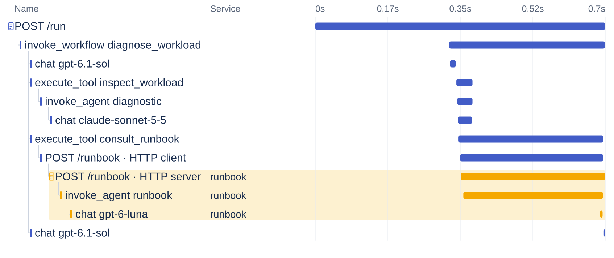
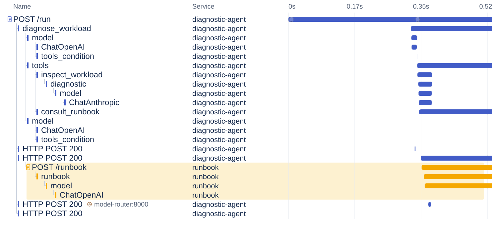
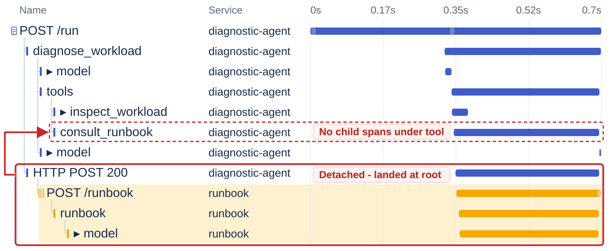
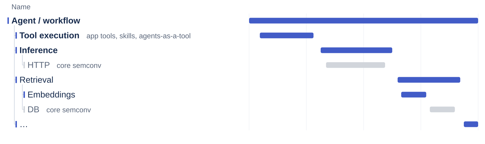
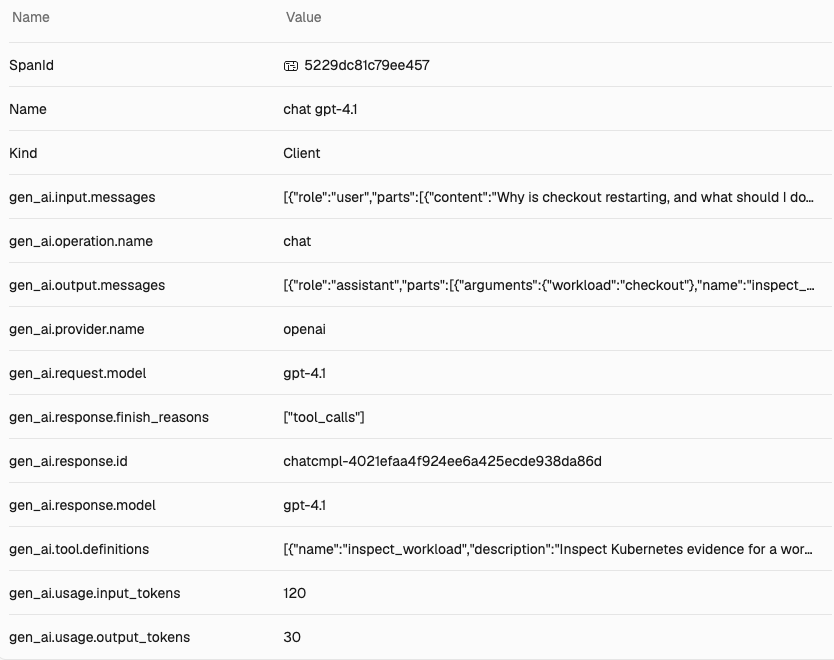
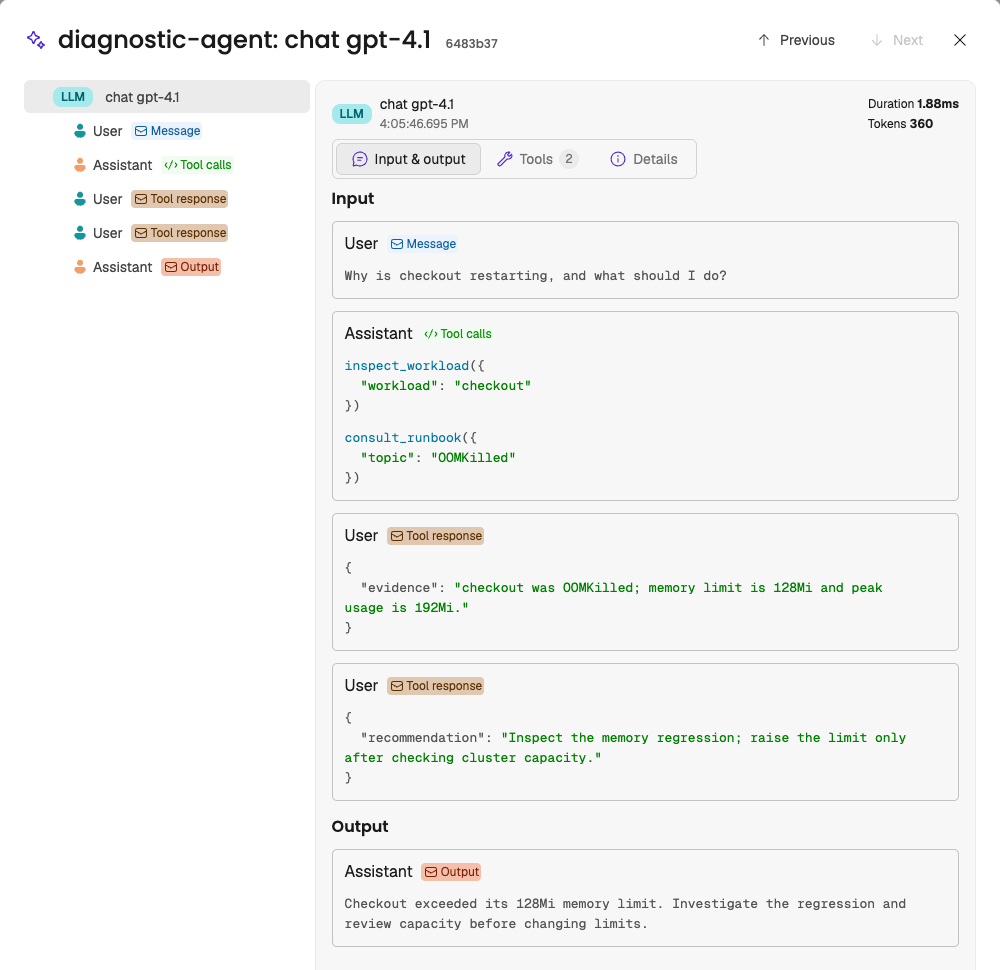
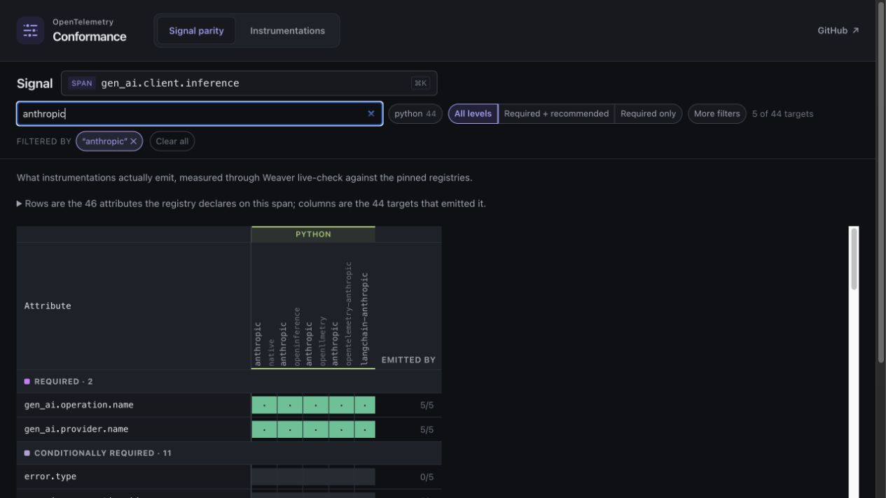

# The Race to Standardize AI Observability

Liudmila Molkova, Google · Trask Stalnaker, Microsoft

KubeCon + CloudNativeCon North America 2026

---

# “Trask, can you help with the dashboard?”

- [x] Instrumentation installed
- [x] OTLP export configured
- [x] Traces arriving
- [ ] Dashboard
- [ ] Validation

---

# Our expectations



---

# The reality



---

# Querying token usage

```sql
SELECT COUNT(*) AS calls,
  SUM("gen_ai.usage.input_tokens") AS input_tokens
FROM span_data
WHERE trace_id = :trace_id
  AND "gen_ai.operation.name" = 'chat';
```

**2 calls · 280 input tokens**

---

# Dashboard usage vs. reality


---

# How did we instrument the application?



---

# Accounting for different schemas

```sql
WITH calls AS (
  SELECT COALESCE(
    "gen_ai.usage.input_tokens",
    "llm.token_count.prompt"
  ) AS input_tokens
  FROM span_data WHERE trace_id = :trace_id AND (
    "gen_ai.operation.name" = 'chat'
    OR lower("openinference.span.kind") = 'llm'
    OR lower("langsmith.span.kind") = 'llm'
  )
)
SELECT COUNT(*) AS calls, SUM(input_tokens) AS input_tokens,
       SUM(input_tokens IS NULL) AS missing_usage FROM calls;
```

**5 inference spans · 900 input tokens · 0 missing usage values**

---

# Where context gets lost



---

# If I had a magic wand

- One schema across all instrumentations
- Proper correlation between them
- Traces, metrics, and logs
- One config for content capture
- Large content separate from telemetry, but reacheable

---

# What did we do in OTel

---

# What OpenTelemetry provides

<div style="display: grid; grid-template-columns: repeat(5, 1fr); gap: 20px; margin-top: 40px;">
<div style="display: flex; flex-direction: column; gap: 14px;"><div style="min-height: 96px; font-size: 21px; font-style: italic; color: var(--cp-text-muted);">One schema across all instrumentations</div><div style="text-align: center; color: var(--cp-text-muted);">↓</div><div style="flex: 1; padding: 20px; border: 3px solid var(--cp-accent); border-radius: 12px; background: var(--cp-accent-soft); font-weight: 600;">GenAI semantic conventions<div style="margin-top: 14px; font-size: 20px; font-weight: 400;">checked by conformance tests</div></div></div>
<div style="display: flex; flex-direction: column; gap: 14px;"><div style="min-height: 96px; font-size: 21px; font-style: italic; color: var(--cp-text-muted);">Proper correlation between them</div><div style="text-align: center; color: var(--cp-text-muted);">↓</div><div style="flex: 1; padding: 20px; border: 3px solid var(--cp-border); border-radius: 12px; background: var(--cp-surface-soft); font-weight: 600;">Context propagation<div style="margin-top: 14px; font-size: 20px; font-weight: 400;">parent span flows across libraries and services</div></div></div>
<div style="display: flex; flex-direction: column; gap: 14px;"><div style="min-height: 96px; font-size: 21px; font-style: italic; color: var(--cp-text-muted);">Traces, metrics, and logs</div><div style="text-align: center; color: var(--cp-text-muted);">↓</div><div style="flex: 1; padding: 20px; border: 3px solid var(--cp-accent); border-radius: 12px; background: var(--cp-accent-soft); font-weight: 600;">Shared GenAI util<div style="margin-top: 14px; font-size: 20px; font-weight: 400;">emits spans, metrics, and events, exported over OTLP</div></div></div>
<div style="display: flex; flex-direction: column; gap: 14px;"><div style="min-height: 96px; font-size: 21px; font-style: italic; color: var(--cp-text-muted);">One config for content capture</div><div style="text-align: center; color: var(--cp-text-muted);">↓</div><div style="flex: 1; padding: 20px; border: 3px solid var(--cp-border); border-radius: 12px; background: var(--cp-surface-soft); font-weight: 600;">Configuration<div style="margin-top: 14px; font-size: 20px; font-weight: 400;">one setting for every OTel GenAI instrumentation</div></div></div>
<div style="display: flex; flex-direction: column; gap: 14px;"><div style="min-height: 96px; font-size: 21px; font-style: italic; color: var(--cp-text-muted);">Large content separate from telemetry, but reachable</div><div style="text-align: center; color: var(--cp-text-muted);">↓</div><div style="flex: 1; padding: 20px; border: 3px solid var(--cp-accent); border-radius: 12px; background: var(--cp-accent-soft); font-weight: 600;">Content upload hook<div style="margin-top: 14px; font-size: 20px; font-weight: 400;">stores content externally, keeps a reference on the span</div></div></div>
</div>
<p style="margin-top: 28px; font-size: 20px; color: var(--cp-text-muted);">Highlighted: covered in the next sections.</p>

---

# GenAI semantic conventions

New home: [semantic-conventions-genai](https://github.com/open-telemetry/semantic-conventions-genai)



---

# GenAI attributes

<div style="display: flex; align-items: center; gap: 32px;">
<div style="flex: 0 0 31%;">
<ul>
<li>Agent / workflow identity</li>
<li>Model details and request parameters</li>
<li>Token usage</li>
<li>Inputs, outputs, and instructions</li>
<li>Tool definitions, calls, and results</li>
</ul>
</div>
<div style="flex: 1; min-width: 0;">

</div>
</div>

---

# Structured inputs and outputs

`gen_ai.input.messages`

```json
[{"role": "user", "parts": [{
  "type": "text",
  "content": "Why is checkout restarting, and what should I do?"
}]}]
```

`gen_ai.output.messages`

```json
[{"role": "assistant", "finish_reason": "tool_calls", "parts": [{
  "type": "tool_call", "id": "call_diagnose",
  "name": "inspect_workload",
  "arguments": {"workload": "checkout"}
}]}]
```

---

# Conversation and tool results



---

# Usage, latency, and errors

| Recorded data | Dashboard question |
| --- | --- |
| Input + output tokens | Where did the tokens go? |
| Cache read + cache creation tokens | How much usage involved caching? |
| Tokens by modality | How much was text, image, or audio? |
| Time to first chunk | How quickly did streaming begin? |
| Duration | Which operation was slow? |
| Calls + errors | How often does this fail? |

---

# From conventions to instrumentation

---

# OpenInference instrumentation donation

**June 16, 2026 · Arize's code donation merged into OTel**

- The community is adopting and adapting the donated instrumentations
- Making them fully vendor-neutral with OTel conventions, configuration, and APIs

---

# How we build instrumentations

New repo: [opentelemetry-python-genai](https://github.com/open-telemetry/opentelemetry-python-genai)

- Shared GenAI Util: spans, metrics, content, context
- Thin adapters: provider data → GenAI Util
- Conformance checks + unit tests
- AI-assisted development and review

```python
with handler.inference("openai", request_model=kwargs["model"]) as operation:
    response = wrapped(*args, **kwargs)
    operation.response_model_name = response.model
    set_usage(operation, response.usage)
    if handler.should_capture_content():
        operation.output_messages = _prepare_output_messages(response.choices)
    return response
```

---

# More contributors, faster delivery

- **26 newcomers to OTel** across Python GenAI + JS AI work
- **13 Python instrumentation packages · 4 beta release rounds**
- JS is adopting the shared-utility and conformance approach
- **359 PRs merged in Python GenAI since launch**


---

# Native SDK instrumentation

- Anthropic tracing, ADK, Azure AI libraries
- MCP Python and .NET, Mistral, LangChain, and many others
- Native instrumentation is good for users and the ecosystem
- Need a way to lib developers to validate conformance

---

# Every instrumentation needs conformance tests

---

# Conformance testing with Weaver

[open-telemetry/semantic-conventions-conformance](https://github.com/open-telemetry/semantic-conventions-conformance)

<div style="display: grid; grid-template-columns: 1fr 1fr 1fr; gap: 24px; align-items: start;">
<div>

**1. Run a library scenario**

```python
from openai import OpenAI

OpenAI().chat.completions.create(
    model="gpt-4o-mini",
    messages=[{
        "role": "user",
        "content": "Say hello",
    }],
)
```

</div>
<div>

**2. Check emitted telemetry**

```sh
weaver registry live-check \
  --registry ./registry \
  --input-source otlp \
  --format json \
  --no-stream \
  --output ./report
```

</div>
<div>

**3. Compare `data.json`**

```json
{
  "spans": {
    "gen_ai.inference.client": [
      "gen_ai.operation.name",
      "gen_ai.request.model",
      "gen_ai.usage.input_tokens",
      "gen_ai.usage.output_tokens"
    ]
  },
  "findings": []
}
```

</div>
</div>

---

# Comparing instrumentation output

TODO: Find a better screenshot.



---

# Adoption across the community

| Project | Progress in 2026 |
| --- | --- |
| Arize / OpenInference | OTel GenAI opt-in flag |
| Anthropic | Native SDK tracing with GenAI attributes |
| OpenLLMetry | GenAI convention adoption |
| OpenTelemetry | Instrumentations, shared utilities, conformance |

---

# Next: stability and adoption

- Initial wave: inference, agents/workflows, and tools across signals
- After: stabilize incrementally, feature by feature
- Improve instrumentation coverage and ergonomics

---

# Next: richer agent telemetry

- Trace steps, skills, and realtime interactions
- Propagate conversation IDs and agent details in context - enable better cost / usage analysis on operation level
- Capture evaluations and guardrail outcomes
- Cover hosted agents and harnesses
- 

---

# How to contribute

TODO

# Thank you!

[GenAI conventions](https://github.com/open-telemetry/semantic-conventions-genai)

[Conformance repository](https://github.com/open-telemetry/semantic-conventions-conformance)

[Conformance reports](https://open-telemetry.github.io/semantic-conventions-conformance/)